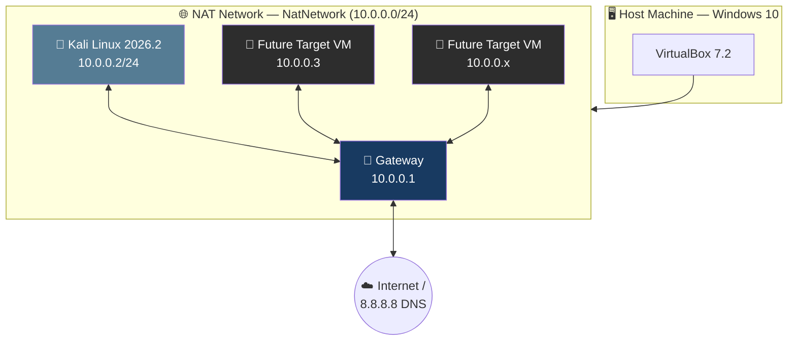
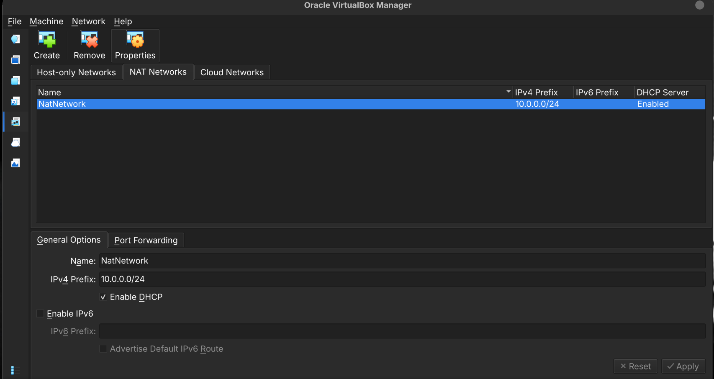
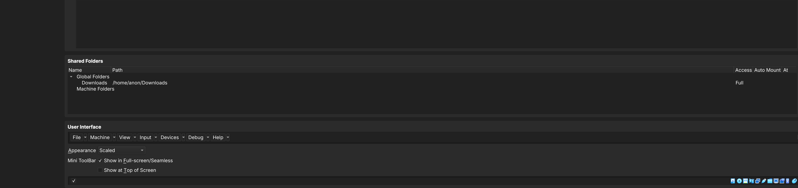
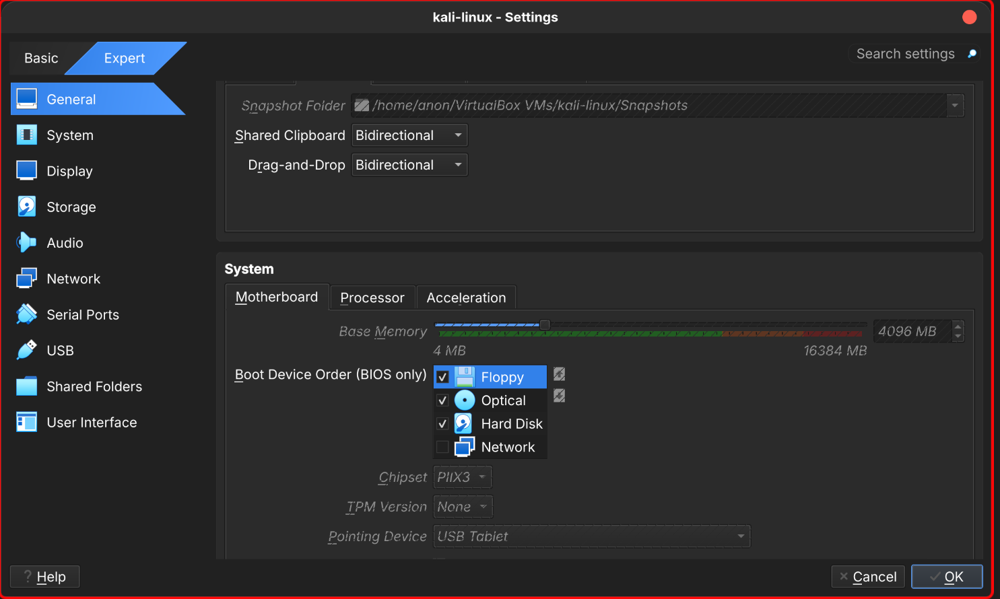
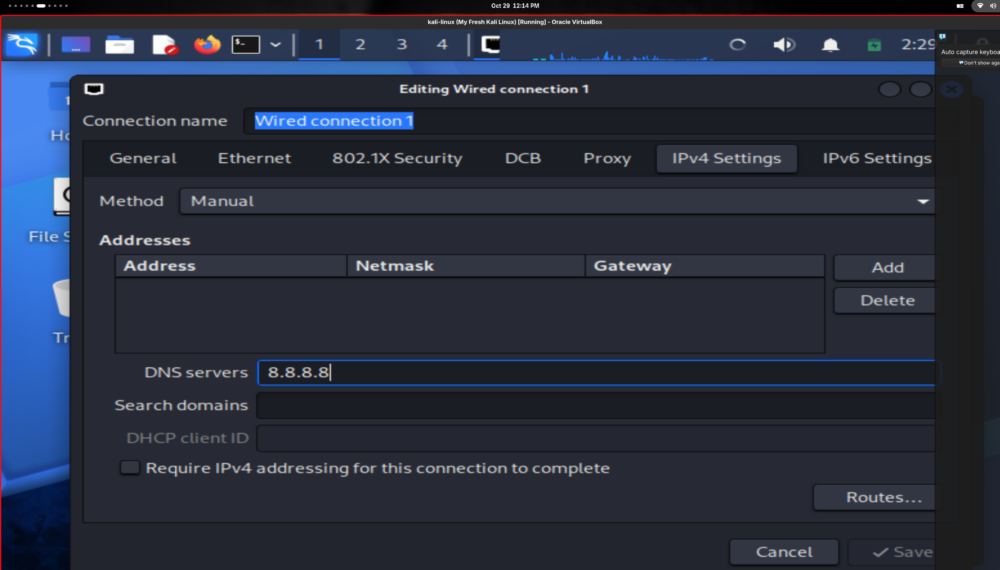
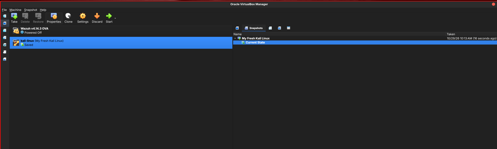
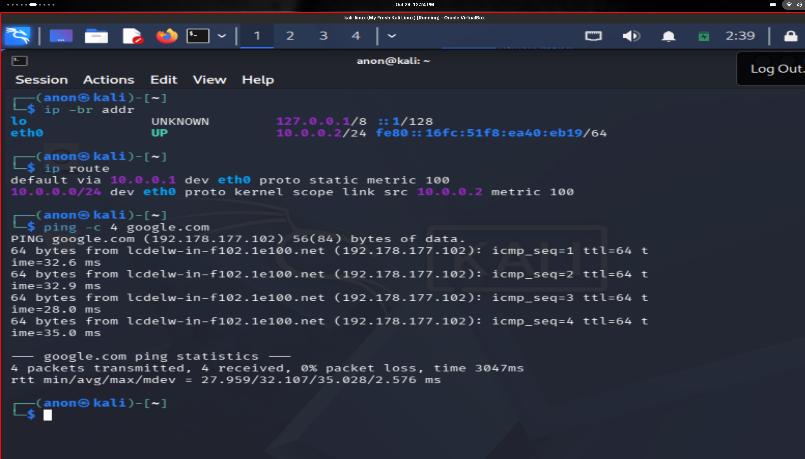

# 🔐 Cybersecurity Lab Environment Setup

**Building an isolated virtual lab for penetration testing and ethical hacking practice**


---

## 📌 Project Overview

This project focuses on setting up a virtual cybersecurity and penetration-testing laboratory using **VirtualBox** and **Kali Linux**.

The purpose of the lab is to create a controlled environment where cybersecurity tools, network scanning, reconnaissance, vulnerability assessment, and other security-testing activities can be performed safely and repeatedly.

The lab is configured on a **private virtual network** so that additional machines can be added later and used as targets for authorized security testing.

---

## 🎯 Objectives

The main objectives of this project are to:

- [x] Install and configure VirtualBox
- [x] Install/import Kali Linux as a virtual machine
- [x] Create a private NAT Network for the cybersecurity lab
- [x] Configure network connectivity for Kali Linux
- [x] Assign a consistent IP address to the Kali VM
- [x] Verify network connectivity and DNS resolution
- [x] Take a clean VM snapshot for recovery
- [x] Document the complete setup process
- [x] Prepare the environment for future cybersecurity projects

---

## 🛡️ Purpose of the Lab

The lab provides an isolated and controlled environment for cybersecurity learning and authorized security testing.

It can be used for activities such as:

| Activity | Description |
| --- | --- |
| 🔎 Network reconnaissance | Discovering hosts and services in the lab network |
| 📡 Port scanning | Identifying open ports and exposed services |
| 🧪 Vulnerability assessment | Evaluating target machines for weaknesses |
| 📦 Packet analysis | Capturing and inspecting traffic with Wireshark/tcpdump |
| 🌐 Web security testing | Practicing against intentionally vulnerable web apps |
| 💥 Exploitation practice | Testing exploits against lab targets only |
| 🧰 Security-tool experimentation | Learning new tools in a safe sandbox |

> [!WARNING]
> **Important:** This laboratory must only be used for systems that you own or have explicit permission to test.
> Do not use the lab or its tools to attack unauthorized systems.

---

## 🏗️ Lab Architecture



Additional target machines can be added to the same virtual network in future projects.

---

## ⚙️ Lab Configuration

| 🧩 Component | ⚙️ Configuration |
| --- | --- |
| 🖥️ Host OS | Windows 10 |
| 🧠 Host RAM | 8 GB |
| ⚡ Processor | Intel Core i7 |
| 🧰 Hypervisor | VirtualBox 7.2 |
| 🐉 Security OS | Kali Linux 2026.2 |
| 🧠 Kali RAM | 2048 MB |
| 🌐 Virtual Network | NAT Network |
| 📡 Network Address | 10.0.0.0/24 |
| 🐧 Kali IP Address | 10.0.0.2/24 |
| 🚪 Default Gateway | 10.0.0.1 |
| 🌍 DNS Server | 8.8.8.8 |
| 🔮 Future VM Range | 10.0.0.3–10.0.0.99 |

---

## 🪜 Lab Setup Procedure

### Step 1. Install 7-Zip

7-Zip was installed to extract the Kali Linux virtual-machine package, which may be distributed as a `.7z` archive.

**Tool:** [7-Zip](https://7-zip.org/download.html)

---

### Step 2. Install VirtualBox

VirtualBox was installed as the hypervisor.

**Tool:** [VirtualBox](https://virtualbox.org/wiki/Downloads)

---

### Step 3. Create the NAT Network

A dedicated NAT Network was created in VirtualBox.

**Configuration:**

| Setting | Value |
| --- | --- |
| Network Name | `NatNetwork` |
| IPv4 Prefix | `10.0.0.0/24` |
| DHCP | Enabled |
| IPv6 | Disabled |

A **NAT Network** was selected because multiple virtual machines connected to the same NAT Network can communicate with one another while also having outbound network connectivity.

This will allow future attacker and target VMs to communicate within the lab.



---

### Step 4. Import Kali Linux

The Kali Linux virtual machine was downloaded from the official Kali Linux website and imported into VirtualBox.

The VM network adapter was configured as follows:

```text
Adapter 1
Attached to: NAT Network
Network:     NatNetwork
Adapter Type: Intel PRO/1000 MT Desktop
```

The VM was allocated:

```text
RAM: 2048 MB
```

A **shared folder** was also configured for transferring required files between the host operating system and the Kali VM.





---

### Step 5. Configure the Kali Linux Network

The Kali Linux network configuration was checked and configured with a consistent IPv4 address.

**Example configuration:**

```text
IP Address:   10.0.0.2
Subnet Mask:  255.255.255.0
Gateway:      10.0.0.1
DNS:          8.8.8.8
```

A consistent IP address makes it easier to document the lab and reference the Kali machine in future exercises.



---

### Step 6. Create a Clean VM Snapshot

After completing the initial configuration, a VirtualBox snapshot was created.

**Example snapshot name:**

```text
Clean Kali - Network Setup
```

The snapshot represents the clean baseline of the laboratory.

If a future exercise changes or damages the VM configuration, the machine can be restored to this baseline.



---

## 🔎 Lab Verification

| ✅ Test | 🧾 Command | 🎯 Expected Result |
| --- | --- | --- |
| 🌐 Check IP address | `ip a` | Correct Kali IP displayed |
| 📡 Test gateway | `ping 10.0.0.1` | Successful replies |
| 🌍 Test Internet connectivity | `ping 8.8.8.8` | Successful replies |
| 🔎 Test DNS resolution | `nslookup networkwalks.com` | Domain resolves |
| 🧰 Verify Nmap | `nmap --version` | Nmap version displayed |
| 🔄 Verify snapshot | Restore snapshot and run `ip a` | Baseline configuration restored |

### Example Results

```text
IP Address:
10.0.0.2/24

Gateway:
10.0.0.1

DNS:
8.8.8.8
```

**Live verification** — interface addressing, routing table, and Internet connectivity from the Kali VM:

```console
anon@kali:~$ ip -br addr
lo               UNKNOWN        127.0.0.1/8 ::1/128
eth0             UP             10.0.0.2/24 fe80::16fc:51f8:ea40:eb19/64

anon@kali:~$ ip route
default via 10.0.0.1 dev eth0 proto static metric 100
10.0.0.0/24 dev eth0 proto kernel scope link src 10.0.0.2 metric 100

anon@kali:~$ ping -c 4 google.com
PING google.com (192.178.177.102) 56(84) bytes of data.
64 bytes from lcdelw-in-f102.1e100.net (192.178.177.102): icmp_seq=1 ttl=64 time=32.6 ms
...
4 packets transmitted, 4 received, 0% packet loss, time 3047ms
rtt min/avg/max/mdev = 27.959/32.107/35.028/2.576 ms
```



---

## 🐞 Problems Encountered & Solutions

Documenting problems is an important part of the project.

### Problem 1. Internet Connectivity After Static IP Configuration

After manually configuring the IPv4 settings, Internet connectivity may fail depending on the Kali/NetworkManager configuration.

One workaround used during this lab was:

```bash
sudo nmcli connection modify "Wired connection 1" ipv4.dad-timeout 0
```

The network connection was then restarted/rebooted and connectivity was tested again.

> [!NOTE]
> Network interface and connection names may differ between systems. Students should first identify their actual connection name before running an `nmcli` command.

---

### Problem 2. VirtualBox VT-x / Virtualization Error

The VM initially failed to start because hardware virtualization was disabled in the system firmware/BIOS.

The issue was resolved by:

1. Restarting the computer.
2. Entering BIOS/UEFI settings.
3. Enabling **Intel VT-x / hardware virtualization**.
4. Saving the configuration.
5. Restarting the computer.
6. Starting the Kali VM again.

After enabling virtualization, the VM started successfully.

---

## 💡 What I Learned

Through this project, I learned how to create and configure a virtual environment for cybersecurity practice.

The most important concepts I learned include:

### 1. NAT vs NAT Network

A standard NAT configuration and a NAT Network serve different purposes.

A NAT Network allows multiple VMs connected to the same virtual network to communicate with one another while providing network address translation for external connectivity.

This makes it useful for building a multi-machine cybersecurity laboratory.

### 2. Virtual Machine Networking

I learned how VirtualBox virtual network adapters connect virtual machines to different types of networks and how network configuration affects communication between machines.

### 3. Static IP Configuration

I learned how to configure and verify IPv4 addressing, subnet masks, gateways, and DNS settings in Kali Linux.

### 4. VM Snapshots

I learned that a clean snapshot should be created before performing risky or experimental activities.

This provides a known-good recovery point for future cybersecurity exercises.

### 5. Documentation

I learned that documenting commands, configuration, screenshots, problems, and solutions is an important part of a professional cybersecurity project.

---

## 🔐 Security & Ethical Use

This laboratory is intended **strictly for education purposes only**.

All testing must be performed against machines you own or have explicit written permission to test. Unauthorized access to systems is illegal and unethical.

---

## 🔗 Tools & Resources

| Tool | Link |
| --- | --- |
| 7-Zip | <https://7-zip.org/download.html> |
| VirtualBox | <https://virtualbox.org/wiki/Downloads> |
| Kali Linux | <https://kali.org/get-kali> |


## 📌 Project Information

| Field | Value |
| --- | --- |
| Program Name | Cybersecurity at Networkwalks |
| Week | 01 |
| Project | Cybersecurity & Pentesting Lab Setup |
| Repository | GitHub — `networkwalks-week1-lab` |
